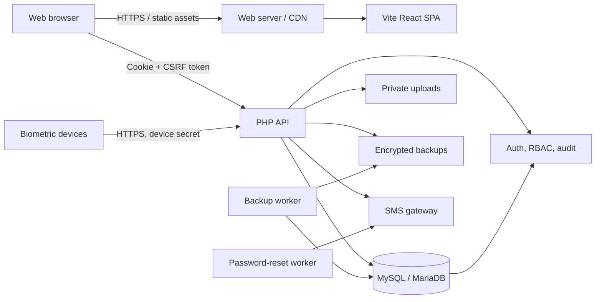

# Ntake School Management System

Ntake is a role-based school-management application for admissions, students,
attendance, fees, marks, reports, library, inventory, SMS, biometrics, and
system administration.

The supported production topology is a React/Vite static frontend with a PHP
API and MySQL or MariaDB. Development also includes an Express process for the
Vite workflow; it is not the production application server.

## Architecture



Browser sessions use an HttpOnly cookie and an in-memory CSRF token. The PHP API
owns database credentials, MFA secrets, SMS credentials, encryption keys, and
audit data. `VITE_*` values are public build-time configuration only.

## Production prerequisites

- Node.js 22 and npm for building the frontend
- PHP 8.1 or later with `pdo_mysql`, `openssl`, `curl`, `mbstring`, and
  `fileinfo`
- MySQL 8 or MariaDB 10.4.32 or later
- A valid TLS certificate and HTTPS reverse proxy or web host
- Separate least-privilege database accounts for runtime, migrations, backups,
  and optional integration tests
- Private, non-web-root storage for uploads, backups, logs, and password
  blocklists
- `mysqldump` and `mysql` on the PHP host for backup and restore operations
- Access to a school-approved SMS provider

Use [INSTALLATION.md](INSTALLATION.md) for deployment and
[docs/cpanel-deployment.md](docs/cpanel-deployment.md) for cPanel.

## Development

```powershell
npm ci
Copy-Item .env.example .env
npm run dev
```

Mock data is development-only and is never persisted to MySQL. Production builds
force `VITE_DATA_SOURCE=api`; never create or deploy a production build with
mock data. Commands:

```powershell
npm run lint
npm run test
npm run test:e2e
npm run build
npm run secret-scan
```

## Pre-production hardening checklist

- [ ] Use HTTPS everywhere and force HTTP to HTTPS.
- [ ] Keep secrets in server-side private configuration, never in `VITE_*`.
- [ ] Create separate runtime, migration, and backup database accounts.
- [ ] Remove or revoke database administrator and broad audit-table privileges.
- [ ] Set `APP_ENV=production`, `display_errors=Off`, and a production host.
- [ ] Set `ALLOWED_ORIGINS` to exact approved frontend origins.
- [ ] Generate unique 32-byte keys for TOTP and backups.
- [ ] Back up encryption keys separately from encrypted artifacts.
- [ ] Install and update a school-approved password blocklist.
- [ ] Require MFA for all roles that enforce it.
- [ ] Protect private upload, backup, and log directories from HTTP access.
- [ ] Configure least-privilege audit-log INSERT/SELECT access.
- [ ] Configure SMS credentials and verify reset delivery.
- [ ] Configure automated backups and worker/cron logging.
- [ ] Complete and document a backup/restore drill.
- [ ] Record retention periods approved by the school.
- [ ] Run dependency, secret, PHP, and browser test suites.

## Backup and restore

Create, verify, and schedule backups only through protected server workers.
The application exposes the backup status; the restore operation is CLI-only
and requires an explicitly named, empty recovery database.

Follow [docs/backup-restore-runbook.md](docs/backup-restore-runbook.md) for
backup configuration, scheduling, verification, restore drills, and recovery
limitations. The drill must confirm:

1. A backup can be created and verified.
2. The backup ID and SHA-256 checksum are recorded.
3. It restores into a new, empty database.
4. Representative users, students, finance, and attendance records are valid.
5. The application health and audit checks pass.
6. Rollback/cutover approval and operator evidence are documented.

Drill at least quarterly and after backup-key or database-host changes.

## Incident response runbook

1. **Contain:** stop scheduled writes/cron workers, revoke compromised sessions
   or credentials, preserve logs and database state, and isolate affected hosts.
2. **Assess:** identify scope, affected roles/data, first/last known good time,
   evidence sources, and whether PII, payments, authentication, or availability
   are affected.
3. **Notify:** engage the incident lead, school data owner, hosting provider,
   SMS provider, and legal/privacy authorities as policy requires.
4. **Recover:** restore only to a reviewed recovery database, validate it, then
   perform an approved cutover. Do not recover by applying ad-hoc SQL to live data.
5. **Preserve evidence:** retain timestamps, backup IDs, checksums, audit logs,
   worker logs, operator actions, and the final root-cause/lessons record.
6. **Close:** rotate all exposed credentials, expire sessions, review MFA and
   role grants, run integrity checks, monitor, and obtain sign-off.

For suspected database compromise, do not delete audit logs or truncate tables.
Preserve a snapshot and use a read-only or isolated recovery environment.

## Key rotation runbook

Rotate TOTP, backup, and biometric keys only with an approved maintenance
window and rollback plan.

- **TOTP key:** back up the old key, deploy the new key, verify MFA enrollment
  and login with a controlled account, and revoke/reevaluate sessions. Existing
  TOTP secrets may become unreadable; plan and communicate re-enrollment.
- **Backup key:** never replace it until retained backups are re-encrypted or
  explicitly accepted for retirement. Test key access and a restore before
  deleting the old key.
- **Database/SMS/cron secrets:** add the new secret, deploy it, test, then revoke
  the old secret. Do not place secrets in source control or build variables.
- **Biometric device secrets:** rotate one device at a time, update its server
  hash and device configuration, verify a test punch, and disable the old secret.

Record the key ID (not the secret), operator, window, dependencies, verification,
old-key retention, deletion date, and rollback outcome.

## Term rollover runbook

Only `system_admin`, `administrator`, `director_of_studies`, or `headteacher`
may change the current academic year/term. Verify first in a staging copy.

1. Create and verify a live backup.
2. Confirm the next year and term dates in the academic setup.
3. Add or activate the academic year and terms before changing the current cycle.
4. Update current academic year and term through the system settings workflow.
5. Configure fee deadline, clearance percentage, and fee schedule for the term.
6. Sync active student fees only after reviewing the schedule and counts.
7. Run promotion and report-check workflows before opening the new term.
8. Verify dashboard totals, attendance access, fee balances, marks, and report cards.
9. Preserve the previous term settings as the audit/approval evidence.
10. During an issue, stop further term changes and roll back only through an
    approved database/configuration recovery process.

Do not run term rollover as a live data import or ad-hoc SQL operation.
